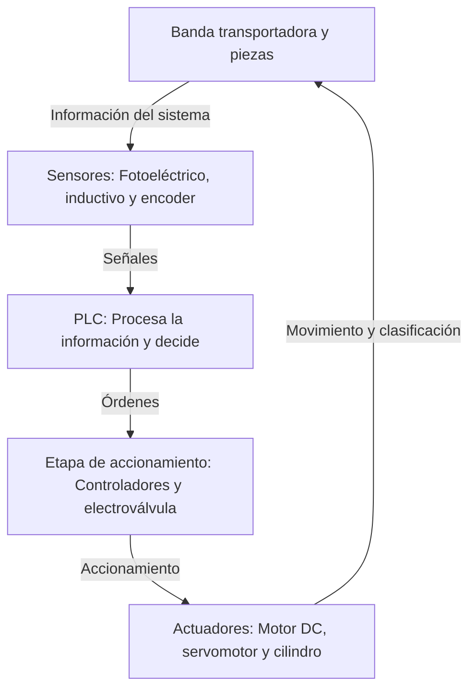

# Investigación sobre sensores y actuadores

**Nombre:** Fernando Emir Walle Hernandez 

**Matrícula:** 2630316

**Asignatura:** Metodologia de la programacion  

**Fecha:** 7 de octubre del 2026

## 1. Conceptos básicos

### ¿Qué es un sensor?

Un sensor es un dispositivo que detecta o mide una condición del entorno y la convierte en información que puede interpretar un sistema electrónico. Puede medir temperatura, luz, presión, distancia y otras variables.

### ¿Qué es un actuador?

Un actuador es un dispositivo que transforma energía en una acción física. Por ejemplo, un motor utiliza electricidad para girar y un cilindro neumático utiliza aire comprimido para empujar un objeto.

### ¿Cuál es la diferencia entre un sensor y un actuador?

El sensor obtiene información y el actuador realiza una acción. Por ejemplo, un sensor detecta una pieza en una banda transportadora y un actuador la empuja hacia otra salida.

### ¿Qué función tienen dentro de un sistema mecatrónico?

Los sensores permiten conocer lo que sucede en el sistema. El controlador recibe esa información, la procesa y envía órdenes a los actuadores.

- **Sensores:** detectan o miden las condiciones.

- **Controlador:** procesa la información y decide qué hacer.

- **Actuadores:** ejecutan las acciones físicas.

Los sensores también permiten comprobar el resultado de una acción. Esta información de regreso se conoce como realimentación.

### Ejemplo: puerta automática

Una puerta automática puede utilizar un sensor de presencia y un motor eléctrico. El sensor detecta a una persona frente a la puerta y envía información al controlador. Después, el controlador activa el motor para abrirla.

- El sensor detecta la presencia de una persona.

- El controlador decide cuándo abrir.

- El motor mueve la puerta.

También puede tener una barrera fotoeléctrica para detectar si alguien está pasando durante el cierre. Este tipo de sensor utiliza un emisor y un receptor de luz para detectar objetos [4].

## 2. Investigación de sensores

Las señales descritas corresponden al ejemplo de cada fila. Una misma variable puede medirse con diferentes tecnologías y tipos de salida.

| Tipo de sensor | Variable que mide | Principio de funcionamiento | Señal que puede entregar | Ejemplo real | Aplicación |
| --- | --- | --- | --- | --- | --- |
| Temperatura | Temperatura. | En una sonda Pt100, la resistencia del platino cambia con la temperatura. Una unidad de medición interpreta ese cambio. | Variación analógica de resistencia; un transmisor puede convertirla en voltaje, corriente o datos digitales. | Sonda Pt100, como la TS2659 de ifm [1]. | Supervisar la temperatura de un proceso. |
| Luz | Nivel de iluminación. | Una fotorresistencia cambia su resistencia según la luz que recibe. Con un divisor de voltaje se obtiene una señal medible. | Analógica: voltaje variable en el circuito de lectura. | Fotorresistencia o LDR utilizada con Arduino [2]. | Encender una lámpara cuando oscurece. |
| Proximidad | Presencia de un objeto cercano. | Un sensor inductivo genera un campo electromagnético que cambia cuando se acerca un objeto metálico. | Digital de conmutación: presencia o ausencia. | Detector inductivo industrial de ifm [3]. | Detectar piezas metálicas en una banda. |
| Distancia | Separación entre el sensor y un objeto. | Un sensor óptico de tiempo de vuelo emite luz y determina la distancia a partir del tiempo que tarda en regresar. | Analógica o digital, según el modelo. | Sensor de distancia de la familia O1D de ifm [4]. | Medir la distancia entre una máquina y una pieza. |
| Presión | Presión de gases o líquidos. | La presión deforma una membrana. El elemento sensible convierte esa deformación en un cambio eléctrico. | Analógica, digital de conmutación o datos mediante IO-Link, según el modelo. | Sensor industrial de presión de ifm [5]. | Supervisar la presión de un sistema hidráulico. |
| Humedad | Humedad relativa del aire. | Un material sensible absorbe humedad y cambia la capacitancia del elemento de medición. | Datos digitales mediante IO-Link, en modelos compatibles. | Sensor de humedad del aire de la familia LDH de ifm [6]. | Vigilar la humedad dentro de un gabinete o instalación. |
| Posición | Posición angular de un eje. | Un encoder absoluto identifica posiciones del eje mediante un disco codificado o un sistema magnético. | Digital: código o datos que representan la posición. | Encoder absoluto industrial de ifm [7]. | Conocer la posición de un mecanismo giratorio. |
| Velocidad o movimiento | Velocidad de giro de un eje. | Un encoder incremental genera pulsos durante el giro. Se calcula la velocidad contando los pulsos por unidad de tiempo. | Digital: trenes de pulsos. | Encoder incremental industrial [7]. | Medir la velocidad de una rueda o banda transportadora. |
| Fuerza o peso | Fuerza aplicada. | La carga deforma ligeramente un cuerpo metálico y modifica la resistencia de las galgas extensométricas adheridas a él. | Analógica: pequeña señal diferencial que requiere acondicionamiento. | Célula de carga Z6 de HBM [8]. | Pesar productos en una báscula industrial. |

**Aclaraciones:**

- La humedad del aire es diferente de la humedad del suelo.

- Un encoder incremental permite calcular velocidad relacionando los pulsos con el tiempo.

- Una célula de carga mide fuerza. Una báscula puede mostrar masa en kilogramos después de calibrarse.

## 3. Clasificación de sensores

### Sensores analógicos y digitales

Los sensores **analógicos** presentan una salida que cambia de manera continua dentro de un intervalo. Por ejemplo, la resistencia de una Pt100 cambia cuando cambia su temperatura.

La característica que permite clasificarlos como analógicos es la variación continua de su señal.

Los sensores **digitales** entregan estados separados, pulsos o información codificada. Un detector de proximidad puede indicar presencia o ausencia, mientras que un encoder absoluto puede entregar una posición numérica.

La característica que los hace digitales es la forma de representar la información. Por eso, un sensor digital no necesariamente mide solo dos valores.

### Sensores de contacto y sin contacto

Los sensores **de contacto** necesitan tocar el objeto o estar acoplados físicamente a él. Por ejemplo, una célula de carga debe recibir la fuerza que se desea medir.

Los sensores **sin contacto** detectan a distancia mediante luz, sonido o campos electromagnéticos. Un ejemplo es un sensor inductivo que detecta una pieza metálica sin tocarla.

La característica que determina la categoría es la necesidad de contacto físico con el objeto.

### Sensores activos y pasivos

Estos términos pueden utilizarse con dos criterios diferentes, por lo que es necesario indicar cuál se está usando.

| Criterio | Activo | Pasivo | Característica de clasificación |
| --- | --- | --- | --- |
| Energía emitida para detectar. | Emite energía hacia el entorno, como un sensor óptico de distancia. | Recibe energía del entorno sin emitir una señal de exploración, como un sensor que recibe luz ambiental. | Si emite energía hacia el objeto para realizar la medición. |
| Conversión de energía del elemento sensible. | Genera una señal eléctrica a partir de la variable, como un termopar. | Necesita excitación externa para medir un cambio de resistencia o capacitancia, como una Pt100 o una LDR. | Si genera la señal por sí mismo o modifica una excitación externa. |

Por ejemplo, una LDR recibe luz ambiental sin emitirla, pero necesita un circuito alimentado para convertir su resistencia en una lectura de voltaje [2].

Estas categorías son independientes: un sensor puede ser analógico y sin contacto al mismo tiempo.

## 4. Investigación de actuadores

| Actuador | Energía utilizada | Movimiento | Funcionamiento general | Ventaja | Limitación | Aplicación |
| --- | --- | --- | --- | --- | --- | --- |
| Motor de corriente directa (DC) | Eléctrica de corriente directa. | Rotatorio continuo. | La interacción entre la corriente de sus devanados y un campo magnético genera un par que mueve el eje. | Permite controlar velocidad y sentido de giro. | Por sí solo no controla una posición exacta. Los modelos con escobillas tienen desgaste. | Mover las ruedas de un robot. |
| Servomotor | Eléctrica. | Rotatorio controlado. | Un sistema de control compara el movimiento medido con el solicitado y corrige el error. | Permite controlar posición, velocidad o par mediante realimentación. | Requiere electrónica de control y una selección adecuada a la carga. | Mover una articulación robótica [9]. |
| Motor paso a paso | Eléctrica. | Rotatorio por incrementos. | Sus bobinas se energizan en una secuencia que desplaza el rotor por pasos. | Permite posicionar mediante pulsos. | Puede perder pasos por sobrecarga si trabaja en lazo abierto. | Mover los ejes de una impresora 3D [10]. |
| Solenoide | Eléctrica. | Lineal de recorrido corto. | Una bobina genera un campo magnético que desplaza un núcleo o émbolo. | Accionamiento sencillo y rápido. | Recorrido limitado y posible calentamiento de la bobina. | Abrir o cerrar una electroválvula [11]. |
| Cilindro neumático | Aire comprimido. | Lineal. | La presión del aire mueve un pistón y su vástago. Una válvula controla el paso del aire. | Adecuado para movimientos rápidos y repetitivos. | Necesita suministro de aire; el posicionamiento intermedio preciso requiere control adicional. | Empujar piezas en una línea de producción [12]. |
| Cilindro hidráulico | Líquido presurizado, normalmente aceite. | Lineal. | El líquido ejerce presión sobre un pistón y transmite fuerza al vástago. | Puede producir fuerzas elevadas. | Requiere bomba, válvulas y mantenimiento; puede presentar fugas. | Levantar el brazo de una excavadora [13]. |

Un servomotor no se define únicamente por su tamaño o apariencia, sino por trabajar dentro de un sistema con realimentación. Los pequeños servos de posición pueden tener un recorrido limitado, mientras que los industriales pueden girar continuamente.

## 5. Comparación de actuadores

### Motor DC y servomotor

Un motor DC básico produce giro continuo. Un servomotor trabaja con un sistema de realimentación para controlar el movimiento y corregir errores.

Elegiría un motor DC con reductora para mover una rueda de un robot porque necesito giro continuo. Para colocar una pequeña articulación en un ángulo determinado, elegiría un servomotor de posición.

Un motor DC puede convertirse en parte de un servosistema al agregar un sensor y un controlador.

### Servomotor y motor paso a paso

El servomotor utiliza realimentación para corregir desviaciones. El paso a paso convencional se mueve siguiendo pulsos y puede trabajar sin medir su posición, aunque existen modelos con realimentación.

Elegiría un paso a paso para una impresora 3D de carga moderada por su movimiento incremental. Para una aplicación rápida con cargas variables, elegiría un servomotor por su capacidad de corregir errores [9], [10].

### Actuador neumático y actuador hidráulico

El neumático funciona con aire comprimido y el hidráulico con líquido presurizado. El aire se comprime con facilidad y el líquido es mucho menos compresible.

Elegiría un cilindro neumático para empujar una pieza ligera de una banda por su rapidez. Para levantar una carga pesada elegiría un cilindro hidráulico por su capacidad de generar fuerza.

La fuerza depende de la presión y del área del pistón. Los sistemas hidráulicos suelen trabajar con presiones mayores.

## 6. Sensores y actuadores en un sistema real

### Sistema seleccionado: banda transportadora de clasificación

Se propone una banda que transporta piezas, identifica cuáles son metálicas y las dirige hacia una salida.

### Sensores

| Elemento | Función |
| --- | --- |
| Sensor fotoeléctrico. | Detecta la llegada de una pieza. |
| Sensor inductivo. | Identifica si la pieza es metálica. |
| Encoder incremental. | Permite calcular el avance y la velocidad de la banda. |

### Actuadores

| Elemento | Función |
| --- | --- |
| Motor DC con reductora. | Mueve la banda transportadora. |
| Servomotor de posición. | Coloca una compuerta en la salida seleccionada. |
| Cilindro neumático. | Extiende o retira un tope para retener la pieza. |

### Secuencia de funcionamiento

1. El motor mueve la banda.
2. El encoder informa sobre su avance.
3. El sensor fotoeléctrico detecta una pieza.
4. El controlador coordina la parada de la banda y el tope.
5. El sensor inductivo identifica si la pieza es metálica.
6. El servomotor coloca la compuerta en la salida elegida.
7. El controlador retira el tope y vuelve a mover la banda.

### Diagrama

El PLC envía las órdenes. La energía para los actuadores proviene de la fuente eléctrica y del suministro de aire. Los controladores de potencia y la electroválvula permiten ejecutar las acciones.

## 7. Selección de componentes

| Situación | Componente elegido | Razón |
| --- | --- | --- |
| Detectar una persona frente a una puerta automática. | Sensor de presencia infrarrojo activo diseñado para puertas. | Detecta personas sin contacto; debe poder reconocer también a una persona quieta. |
| Medir la temperatura dentro de un salón. | Sonda Pt100 con una unidad de lectura. | Su resistencia cambia con la temperatura y permite obtener una medición del ambiente. |
| Detectar el nivel de agua de un depósito. | Interruptor de nivel con flotador. | Indica cuándo el agua alcanza un nivel determinado. |
| Mover una rueda de un robot móvil. | Motor DC con reductora. | Produce giro continuo y proporciona mayor par en la rueda. |
| Controlar el ángulo de una pequeña articulación robótica. | Servomotor de posición. | Permite ajustar el ángulo mediante realimentación. |
| Empujar una pieza en una línea de producción. | Cilindro neumático. | Produce un movimiento lineal rápido cuando existe suministro de aire. |
| Medir la distancia entre un robot y una pared. | Sensor óptico de distancia por tiempo de vuelo. | Mide sin contacto, siempre que la pared esté dentro de su rango. |
| Detectar si una habitación está iluminada. | LDR con divisor de voltaje. | Permite comparar el nivel de luz con un umbral establecido. |

## Reflexión final

Medir una variable significa obtener información sobre una condición, como la temperatura, la distancia o la posición de una pieza. Realizar una acción física significa modificar algo, por ejemplo, mover una rueda o abrir una compuerta. Por eso los sensores y los actuadores tienen funciones distintas, aunque trabajan juntos.

Un sistema mecatrónico normalmente necesita ambos porque debe conocer lo que ocurre antes de decidir cómo actuar. Además, los sensores permiten comprobar el resultado de una acción y corregir errores. Sin esa información, el sistema podría seguir moviéndose aunque hubiera un obstáculo o una pieza estuviera mal colocada.

El servomotor me pareció el actuador más interesante porque puede ajustar su posición mediante realimentación. Esto lo hace útil en articulaciones robóticas y mecanismos que necesitan movimientos controlados. También me ayudó a entender que producir movimiento no es lo mismo que controlar con precisión dónde debe quedar un mecanismo.

## Referencias

Se indica **s. f.** cuando no se identificó una fecha de publicación. Las fuentes siguientes están disponibles en español.

1. **ifm electronic.** **Tecnología de medición de temperatura**. s. f.  

   https://www.ifm.com/mx/es/shared/productos/temperature/tecnologia-de-medicion

   **ifm electronic.** **Sensor de temperatura con cable y sonda de rosca — TS2659**. s. f.  

   https://www.ifm.com/mx/es/product/TS2659

2. **Universidad Nacional Autónoma de México, Escuela Nacional Preparatoria.** **Sistema de iluminación nocturna con fotorresistencia**. s. f.  

   https://iaciduino.enp.unam.mx/index.php/practicas-con-dasa/sistema-de-iluminacion-nocturna-con-fotoresistencia/

3. **ifm electronic.** **Sensores inductivos: funcionamiento y detección de metales en la industria**. s. f.  

   https://www.ifm.com/mx/es/mx/conoce-mas/sensores/sensor-inductivo

4. **ifm electronic.** **Vista general de tecnologías: sensores fotoeléctricos**. s. f.  

   https://www.ifm.com/es/es/shared/technologies/magic-cube/sensores-fotoelectricos

5. **ifm electronic.** **Tecnologías de los sensores de presión**. s. f.  

   https://www.ifm.com/mx/es/shared/productos/drucksensoren/tecnologias-de-los-sensores-de-presion

6. **ifm electronic.** **Sensor de humedad del aire: ventajas y tecnología**. s. f.  

   https://www.ifm.com/ar/es/shared/landingpages/ldh/ventajas-y-tecnologia-del-sensor-de-humedad-del-aire

7. **ifm electronic.** **Los encóders de ifm de un vistazo**. s. f.  

   https://www.ifm.com/mx/es/shared/technologies/drehgeber/que-son-los-encoders

8. **HBM.** **Células de carga de flexión/barra robustas, fácil limpieza**. s. f.  

   https://www.hbm.com/es/7398/celulas-de-carga-de-flexion-barra-robustas-facil-limpieza/

9. **Festo.** **Motores y reguladores de servoaccionamiento**. s. f.  

   https://www.festo.com/mx/es/c/productos/motores-y-reguladores-de-servoaccionamiento-id_pim13

10. **Festo.** **Motores paso a paso**. s. f.  

    https://www.festo.com/mx/es/c/productos/motores-y-reguladores-de-servoaccionamiento/motores-paso-a-paso-id_pim102

11. **Bürkert.** **¿Qué es una electroválvula y cómo funciona?**. s. f.  

    https://www.burkert.es/es/empresa-y-carrera/actualidades/prensa/mediateca/informes-tecnicos/que-es-una-electrovalvula-y-como-funciona

12. **Festo.** **Cilindros neumáticos**. s. f.  

    https://www.festo.com/mx/es/c/productos/actuadores/cilindros-neumaticos-id_pim135

13. **Bosch Rexroth.** **Cilindros hidráulicos**. s. f.  

    https://www.boschrexroth.com/es/es/c/cilindro/
